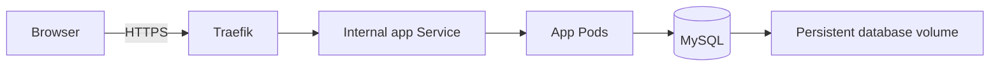

# Clear Day

Clear Day is a lightweight shared task workspace and an end-to-end DevOps
learning project, adapted from Docker's Getting Started Todo App. The UI supports
adding, completing, deleting, searching, and filtering tasks, with progress and
error states. There is no login or per-user task ownership.

## Start reading here

| Guide | What you will learn |
| --- | --- |
| [Learning journey](docs/learning-journey.md) | The lessons in order, with explanations, commands, and checkpoints |
| [Architecture](docs/architecture.md) | How the UI, API, database, containers, Kubernetes, and GitOps fit together |
| [Setup and infrastructure](docs/setup.md) | Recreate the local environment, credentials, routing, and HTTPS |
| [Daily operations](docs/operations.md) | Make releases, inspect workloads, scale, and recover a bad deployment |
| [Backup and recovery](docs/recovery.md) | Back up MySQL, test restoration, and rebuild a missing cluster |
| [Troubleshooting](docs/troubleshooting.md) | Diagnose the issues encountered during the project |
| [Glossary](docs/glossary.md) | Plain-language definitions of technical terms |

The guides describe the repository checked on November 18, 2026 and the lessons
completed in this project. Commands are for Windows PowerShell unless marked
SQL or Linux shell. Execute setup commands only when needed, not as a checklist
to rerun against a healthy environment. They are documented procedures, not an
automated installation script or a production certification.

## Current application entry point

Open **https://clearday.localhost** on the configured development computer.
HTTP redirects to HTTPS. Traefik terminates TLS and forwards to the internal
`todo-app` ClusterIP Service, port 8082, then Express port 3000. The Service no
longer publishes `localhost:8082` to Windows.

Argo CD is at **https://localhost:8083**, with its own local certificate behavior
and admin credentials. The Clear Day certificate does not secure Argo CD.



## Quick development and build commands

From the repository root:

```powershell
docker compose config --quiet
docker compose up --watch
```

The Compose development stack uses http://localhost and http://db.localhost.
Its proxy also needs host port 80, which conflicts with the Kubernetes Traefik
listener. Choose one port-80 environment at a time. Compose and Kubernetes have
separate databases; starting Compose will not show Kubernetes tasks.

```powershell
docker compose down
docker build --target test --progress=plain .
docker build -t clear-day:local .
docker run -d --name clear-day-local -p 8084:3000 -v clear-day-local-data:/etc/todos clear-day:local
```

The standalone image uses SQLite unless MySQL environment settings are supplied.
Choose an unused port/name if a preview already occupies 8084. `compose down`
retains its named volume; `down -v` deletes it. Do not use volume deletion as a
normal troubleshooting step.

## Delivery workflow

```text
Code PR → tests + manifest validation → merge → final image published to GHCR
Deployment tag PR → merge → Argo CD automatic sync → Kubernetes rolling update
```

Publishing alone does not deploy a new app version. The reviewed Deployment
image tag selects the version. One short-lived branch can contain several
related commits and documentation updates; a branch per tiny edit is unnecessary.

## Security and persistence boundaries

- The app is a shared list with no authentication. HTTPS is not access control.
- Real passwords, private keys, Secret exports, and SQL backups stay outside Git.
- App account: `todo_app`; root credentials are reserved for administration.
- MySQL has one Pod and a 1 GiB PVC. App replicas do not make it highly available.
- A PVC is not a backup. The local SQL backup is not protection against losing
  the whole laptop; a separate protected copy is needed for that.
- Metrics Server's kubelet TLS exception is limited to the local learning setup.
- Argo CD auto-sync is on; prune and self-heal are off.

## Repository map

```text
client/                    React UI and Vite build
backend/src/               Express API and database adapters
backend/spec/              Jest tests
Dockerfile                 Multi-stage development, test, and final image
compose.yaml               Five-service local development stack
.github/workflows/ci.yml    Validate, test/build, and publish
k8s/                       Application manifests watched by Argo CD
infrastructure/argocd/     Argo CD Application and dashboard Service
infrastructure/traefik/    Pinned Helm installation instructions and values
docs/                      Learning, operating, and recovery handbook
```

## Known follow-ups

The app manifest currently still declares `replicas: 2`; HPA also manages the
count. Remove that field in a separate reviewed configuration change to avoid
resetting the HPA count during future syncs. CI still triggers on all pushes and
PRs, so a learning branch with a PR can have two runs. Legacy client components
and dependencies remain unused by the Clear Day UI. See the guides for further
limits; documentation does not silently change any of these settings.

## Credits and license

Based on [Docker's Getting Started Todo App](https://github.com/docker/getting-started-todo-app).
The Clear Day presentation and learning documentation replace the sample UI and
guide. Retain the original Apache 2.0 license and applicable attribution in
[LICENSE](LICENSE).
