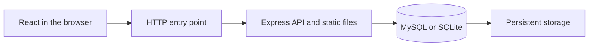
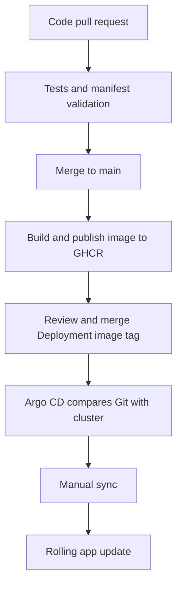

# Clear Day architecture

## Request and data flow

React keeps a local view of tasks. It loads `/api/items`, then updates local
state only after successful API mutations. Failed requests leave the displayed
tasks unchanged and show a retry message. Search and view filters run in the
browser; they do not create extra database queries. Counts and completion
progress describe the whole loaded list, not just search results.

The server remains the source of truth. Other browsers' changes appear after
reload; there is no real-time synchronization. No login or user ownership is
implemented. Search is client-side and the API currently returns the full list,
so this design suits small shared lists rather than very large datasets.

## Frontend

React and Vite build the UI. `App.jsx` contains the workspace, form, filters,
search, progress, loading/empty/error states, and task actions. The stylesheet
uses system fonts, responsive breakpoints, visible keyboard focus, and reduced
motion support. Native form controls provide checkbox and keyboard behavior.

Bootstrap, React Bootstrap, and Font Awesome remain declared in the inherited
package manifest for compatibility with unused legacy components. The active
app no longer imports those components or Bootstrap CSS, so they are not part
of the active UI dependency graph. Removing legacy files and dependencies can
be a separate cleanup with lockfile updates.

## API

| Method | Path | Behavior |
| --- | --- | --- |
| GET | `/api/items` | Load all tasks |
| POST | `/api/items` | Create `{ name }` |
| PUT | `/api/items/:id` | Update `{ name, completed }` |
| DELETE | `/api/items/:id` | Remove a task |
| GET | `/api/greeting` | Legacy configurable greeting; not shown in the new UI |
| GET | `/api/health/live` | HTTP liveness |
| GET | `/api/health/ready` | Database readiness |

A task retains the existing `{ id, name, completed }` schema. This redesign
needs no database migration. The greeting endpoint and ConfigMap remain usable
for learning exercises, even though the new interface has its own heading.

## Runtime environments

Development Compose uses Traefik to route `/api` to Express and page/assets to
Vite. MySQL holds tasks in a named volume. Vite and nodemon support local edits.

The multi-stage Dockerfile builds the frontend, tests the backend, and copies
compiled assets into `backend/src/static` in the final image. Express serves
both UI and API on port 3000. Without `MYSQL_HOST`, it stores SQLite data at
`/etc/todos/todo.db` (or the configured SQLite path).

Kubernetes uses app Pods behind a Service and a separate MySQL Deployment with
a PVC. Secrets supply database credentials. ConfigMaps supply ordinary settings.
Startup and liveness probes check HTTP responsiveness; readiness checks database
access. HPA changes app replica count using Metrics Server's CPU readings. The
app Deployment should omit `spec.replicas` when HPA owns scaling. MySQL remains
single-instance; multiple app Pods do not make the database highly available.

## Delivery

Git contains desired configuration; Argo CD applies it. Neither replaces SQL
backups or password provisioning. Backups and Secret values must stay outside
Git. The local cluster is a learning environment, not a production availability
or security guarantee.
