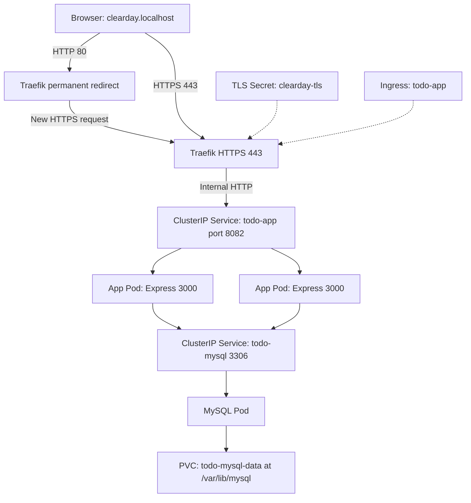
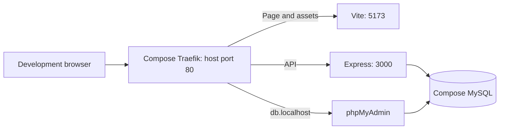
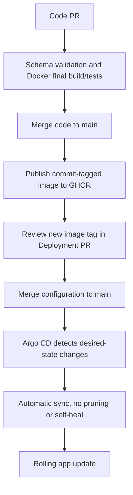

# Architecture: how Clear Day works

[Documentation home](../README.md) · [Learning journey](learning-journey.md)

## 1. Three logical layers

| Layer | Technology | Responsibility |
| --- | --- | --- |
| Browser frontend | React, built with Vite | Display tasks and send HTTP requests |
| Backend | Node.js 22 image, Express | Handle API requests and call persistence functions |
| Persistence | MySQL or SQLite | Store task records independently of the browser |

React runs in the browser, not inside the database or as server-side rendering.
Express serves compiled assets in the final image and JSON from the same origin.
The browser uses relative `/api/...` URLs, so the same UI works behind Compose,
a standalone port mapping, or HTTPS Ingress without hard-coded backend hosts.

## 2. Actual Kubernetes request path

Services select Pods using `app: todo-app` or `app: todo-mysql` labels. The
Service's stable name remains while Pod names/IPs change. EndpointSlices record
ready destinations. Traefik may route to backend endpoints internally; the
Service in the diagram represents the Kubernetes backend selected by Ingress.

TLS is terminated at Traefik. Traffic from Traefik to Express remains HTTP.
The current database client configuration does not explicitly enable TLS.
The local CA is trusted by the development computer, not automatically by
other devices. Browser-trusted HTTPS does not add users, authorization, or
at-rest database encryption.

## 3. Follow one task through the code

1. The user submits a nonempty task in `client/src/App.jsx`.
2. The browser sends `POST /api/items` with `{ "name": "Learn GitOps" }`.
3. Ingress/Traefik sends the request to the app backend.
4. `backend/src/index.js` parses JSON and selects `routes/addItem.js`.
5. The handler creates a UUID and sets `completed: false`.
6. The persistence adapter inserts the record using parameterized SQL.
7. Express returns the saved task as JSON.
8. React appends the returned record to its state and updates the display.

Completion uses PUT with the name and new completion state. Delete uses DELETE.
The UI updates task data only after successful responses and displays errors
for failures. Reloading fetches persisted tasks again. Search/filter state is
local to that browser and is not stored as task data.

| HTTP method | Path | Purpose |
| --- | --- | --- |
| GET | `/api/items` | Retrieve all tasks |
| POST | `/api/items` | Create task |
| PUT | `/api/items/:id` | Update name/completion |
| DELETE | `/api/items/:id` | Remove task |
| GET | `/api/greeting` | Read configurable legacy greeting |
| GET | `/api/health/live` | Return 200 if Express responds |
| GET | `/api/health/ready` | Return 200 for DB check success, 503 for failure/timeout |

A task retains `{ id, name, completed }`. The readiness SQL `SELECT 1` checks a
working query connection, not the existence/permissions of every application
table. Its handler races against a two-second timer, which does not cancel
an underlying query. Probe request timeout is three seconds. The backend first
initializes its database before listening at all; during initial startup a
missing DB can still cause process exit and restart.

## 4. Clear Day frontend

`client/src/main.jsx` mounts `App.jsx` in React StrictMode. The active App renders
navigation, task counts, progress, search, filters, add/completion/delete actions,
loading/empty/error states, and accessible native controls. Styling is in
`client/src/index.scss`, with responsive breakpoints and reduced-motion support.
There is no external font request. The active UI does not import Bootstrap or
Font Awesome, although inherited dependencies and old components remain in the
repository. The greeting API is no longer the page heading.

State lives in React; the durable source is the database. There is no websocket,
polling, pagination, or per-user isolation. Another client's changes appear on
reload. This suits a small shared learning list, not huge datasets.

## 5. Database selection and credentials

`backend/src/persistence/index.js` selects MySQL when `MYSQL_HOST` exists;
otherwise SQLite. Both adapters expose CRUD, initialization, teardown, and
`checkHealth`. SQLite defaults to `/etc/todos/todo.db` and creates its directory.
Both adapters create `todo_items` if needed.

Kubernetes supplies `MYSQL_HOST=todo-mysql`, `MYSQL_DB=todos`, and
`MYSQL_USER=todo_app`. Its password comes from `todo-app-db-secret/password`.
The MySQL Pod initializes its root password from
`todo-mysql-secret/mysql-root-password`. These are references, not passwords in
Git. The app account has SELECT, INSERT, UPDATE, DELETE, CREATE on `todos.*`.
CREATE is needed for startup table initialization. Changing Secret text alone
does not change passwords already stored inside MySQL.

## 6. Development versus final image

Compose uses the Docker provider and labels; Kubernetes Traefik uses Ingress
resources. They are different installations. Compose watch syncs source; Vite
handles frontend changes and nodemon restarts backend code. Watched package.json
changes rebuild. Other files, such as lockfiles and config, are not all watched.
Only the proxy publishes a host port explicitly. Backend waits for MySQL's
healthcheck, and the adapter also waits for the TCP port.

| Dockerfile stage | What it produces |
| --- | --- |
| base | Node 22 environment and `/usr/local/app` working directory |
| client-base | Frontend dependencies and source |
| client-dev | Vite development command |
| client-build | Static compiled frontend in `dist` |
| sqlite3-build | Explicitly compiled native SQLite module |
| backend-dev | Backend dependencies, specs, source, nodemon command |
| test | Backend Jest results from `RUN npm run test` |
| final | Production dependencies, backend, compiled frontend |

The `.npmrc` disables install scripts; the SQLite stage explicitly compiles its
native binding. Manifest/lockfiles are copied before source to reuse dependency
cache layers. Final copies package files from test, making test a dependency of
the final build (a prior successful cached test layer may be reused). Compose's
development targets do not automatically build test/final. `EXPOSE 3000` is
metadata, not a host port mapping. `CMD` runs at container startup; `RUN` executes
while building. Image layers do not include mounted live database volumes.

## 7. Kubernetes resources and ownership

| File/resource | Role |
| --- | --- |
| `k8s/deployment.yaml` | App image, environment, probes, CPU/memory, rolling strategy |
| `k8s/service.yaml` | Internal ClusterIP 8082 -> app 3000 |
| `k8s/mysql.yaml` | One MySQL Pod with Recreate strategy and internal Service |
| `k8s/mysql-pvc.yaml` | 1 GiB RWO storage request |
| `k8s/configmap.yaml` | Ordinary GREETING configuration |
| `k8s/hpa.yaml` | App CPU autoscaling: 2–4 Pods, 50% request target |
| `k8s/ingress.yaml` | Hostname, websecure entry point, TLS Secret reference |
| `k8s/pvc.yaml` | Historical SQLite claim, excluded from Argo CD |
| `infrastructure/argocd/` | Application definition and dashboard LoadBalancer |
| `infrastructure/traefik/` | Helm values and pinned install instructions |

The app requests 100m CPU / 128Mi and limits 500m / 256Mi. CPU above the limit
is throttled; excessive memory can cause OOM termination. HPA's 50% is 50m per
Pod on average, not 50% of the laptop. Metrics Server supplies recent CPU/memory,
not historical dashboards. A one-node cluster, one MySQL Pod, and one laptop
remain shared failure points despite multiple app Pods.

Current source caveat: `spec.replicas: 2` remains in the app Deployment. A future
reviewed change should remove it so Git syncs do not reset HPA's chosen count.
MySQL must retain its own `replicas: 1` until a replication design is introduced.

## 8. Delivery and management boundaries

CI currently runs on all pushes and PRs. Login/push steps only run for pushes to
main. Repository name is lowercased for GHCR, and full `GITHUB_SHA` is the image
tag. `GITHUB_TOKEN` is a temporary job credential with package-write permission,
not a personal password. Logout cleans Docker's saved credential after the job.

Argo watches main/k8s and excludes exactly pvc.yaml, not mysql-pvc.yaml. It
manages app configuration; Helm manages Traefik separately. Installing Argo,
applying its own Application definition, recreating Secrets, and restoring SQL
are bootstrap/administration actions, not automatic image-selection features.
Self-heal false disables correction of drift at the same revision; a new Git
revision can still reapply desired state. Git is the durable release record.

## References

- [Docker multi-stage builds](https://docs.docker.com/build/building/multi-stage/)
- [Kubernetes concepts](https://kubernetes.io/docs/concepts/)
- [Argo CD](https://argo-cd.readthedocs.io/en/stable/)
- [Traefik chart](https://github.com/traefik/traefik-helm-chart)

These links are follow-up reading; the versioned repository files are the
primary source for the configuration described here.
